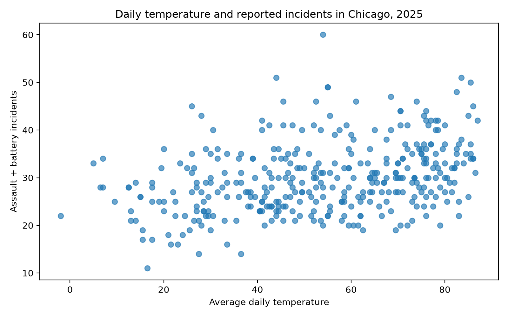
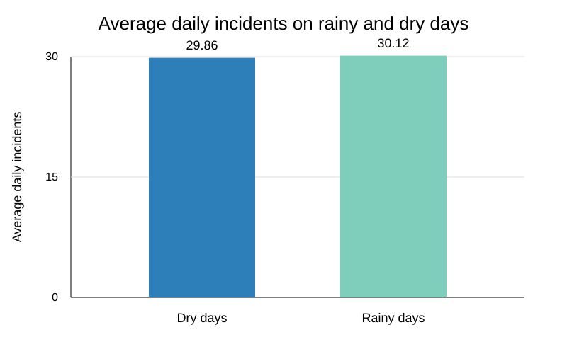
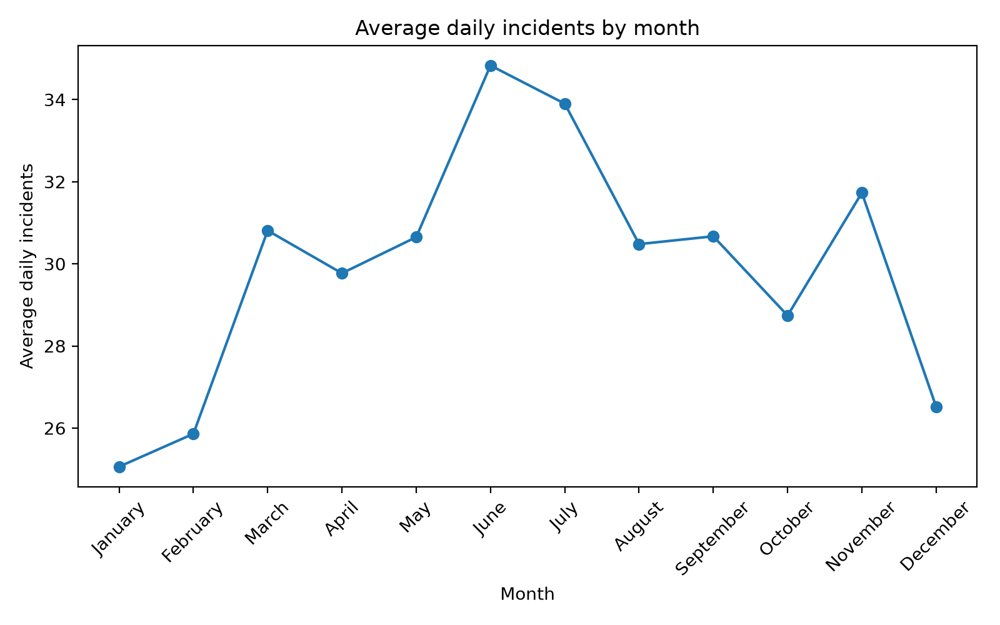
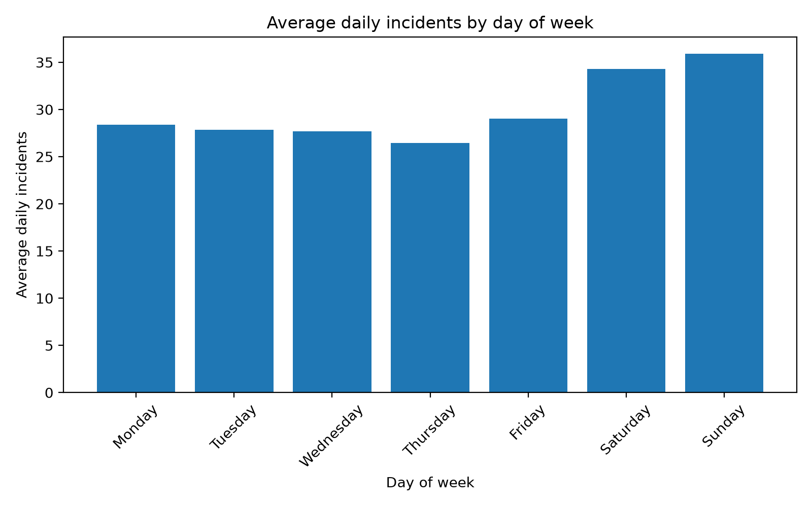

# Findings

The final dataset contains 365 daily observations from 2025 and 10,925 reported assault and battery records. The average day contained 7.40 assault incidents and 22.53 battery incidents, for an average of 29.93 combined incidents.

## Temperature and incidents

The Pearson correlation between average daily temperature and combined assault and battery incidents was **0.354**. The correlation was **0.257** for assault and **0.292** for battery. These values show a modest positive association: warmer days tended to have more reported incidents in this dataset. The relationship is not proof that temperature caused the incidents.

**Figure 1.** Average daily temperature compared with combined assault and battery incidents in Chicago during 2025.

## Precipitation comparison

The correlation between precipitation and combined incidents was **-0.013**, which is very close to zero. The average was **30.12 incidents on rainy days** and **29.86 incidents on dry days**. This preliminary comparison does not show a meaningful difference between rainy and dry days.

**Figure 2.** Average daily assault and battery incidents on rainy and dry days.

## Monthly pattern

Monthly averages varied during the year. June had the highest average at **34.83 incidents per day**, followed by July at **33.90**. January had the lowest average at **25.06 incidents per day**. This pattern is consistent with the modest positive temperature relationship, although month and season may be influencing both temperature and incident counts.

**Figure 3.** Average daily assault and battery incidents by month.

## Day-of-week pattern

Incident counts also varied by day of week. Sunday had the highest average at **35.90 incidents per day**, followed by Saturday at **34.27**. Thursday had the lowest average at **26.44**. Because weekday patterns may affect the temperature comparison, future analysis should control for day of week.

**Figure 4.** Average daily assault and battery incidents by day of week.

Overall, the exploratory results suggest that temperature has a modest positive association with reported assault and battery incidents, while precipitation has little apparent association. These findings are preliminary and describe correlation rather than causation. The analysis uses one weather station and one year of reported crime data, so the results may not represent all neighborhoods or other years.
